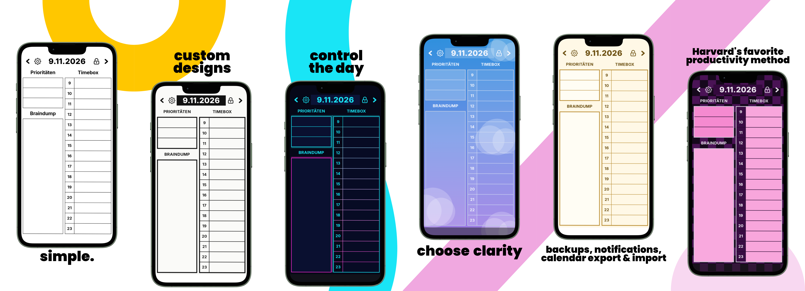
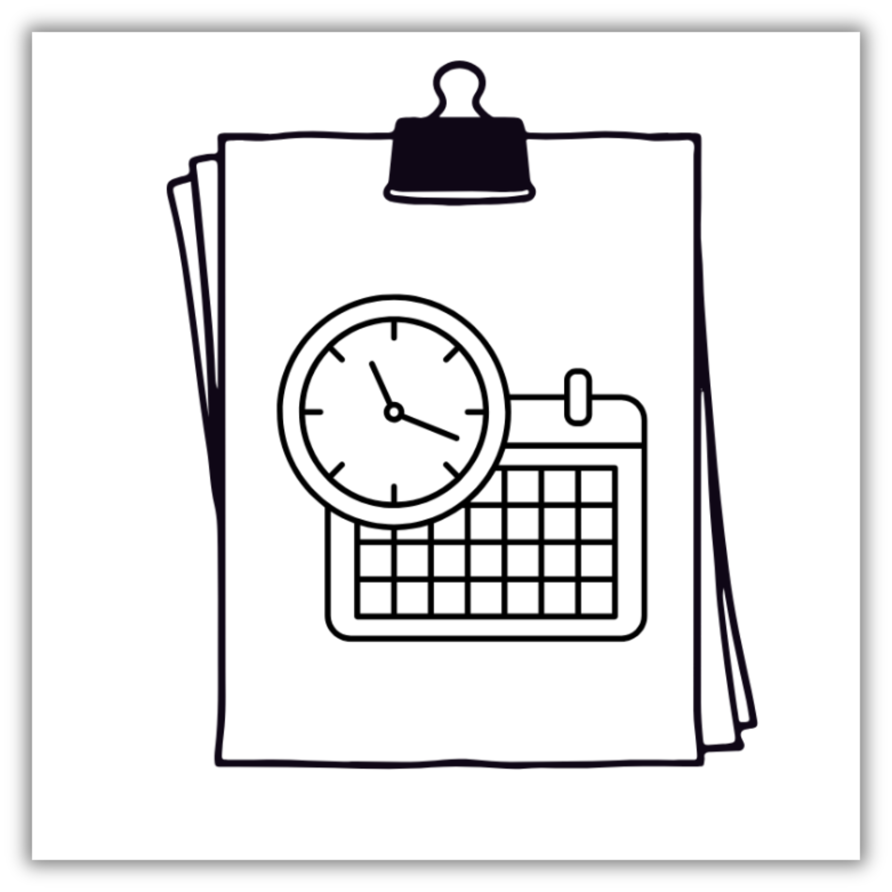

  

<h2 align="center">Timebox</h2>

  

<h3 align="center">Harvard's Favorite Time Management Method</h3>

### Core Functions
* **Timetable ("timebox")**
* **Top Priorities** — 1 up to 10
* **Braindump** — notes & sketches

### Features
* **customize** — language, theme, times, notifications, titles, password, icons, backups, ...
* **simple** — enjoy clean interfaces & widgets
* **effective** — shows to be Harvard's "most productive" method for time management — personally & professionally
* **not done yet** — more specification settings are on their way ...

### Hidden Features (already built in 😱)
* backups
• PDF export
• daily calendar import & export
• password settings
• notifications
• sketching
• daily journaling
• "lock in" mode
• WIDGETS on Android

---
### Languages 🌎
* Deutsch 🇩🇪
* English 🇺🇸
* under development
---

### ❤️ Donations
*Stripe Link:* [much thanks](https://donate.stripe.com/eVq3cv8XAbah7W3gSm8bS00)

### 👨‍⚖️ Legal Stuff
Copyright © 2026 F. H. (richyrichs-daylab). All Rights Reserved.
This repository is public for preview and showcase purposes only. Unauthorized copying, redistribution, or commercial use is strictly prohibited.
